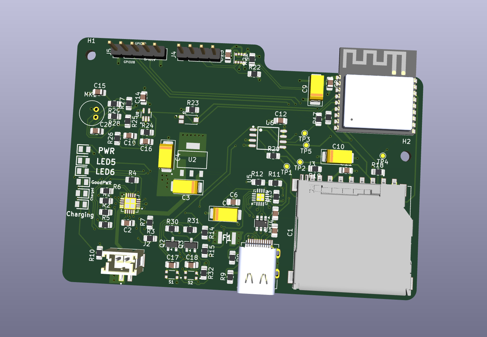
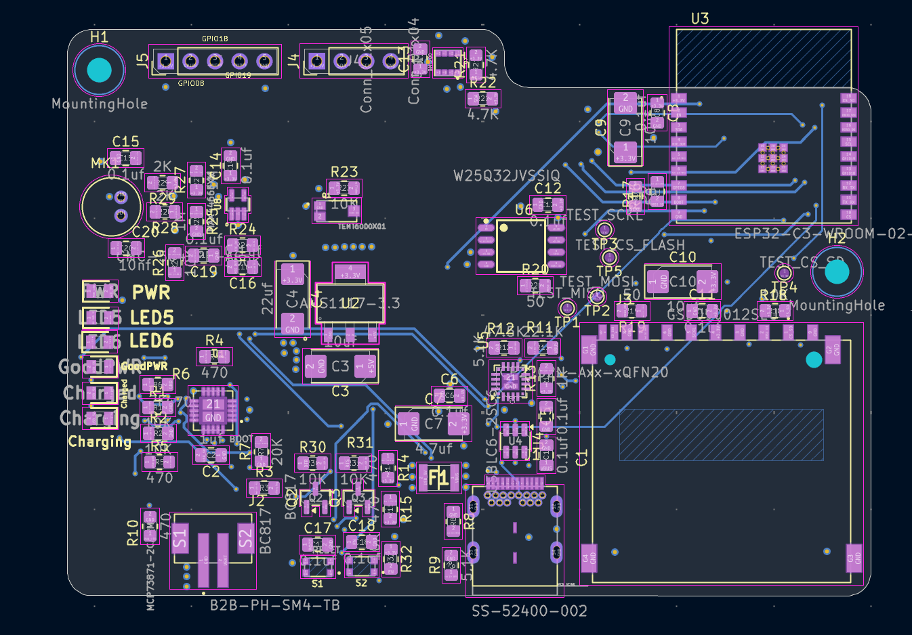
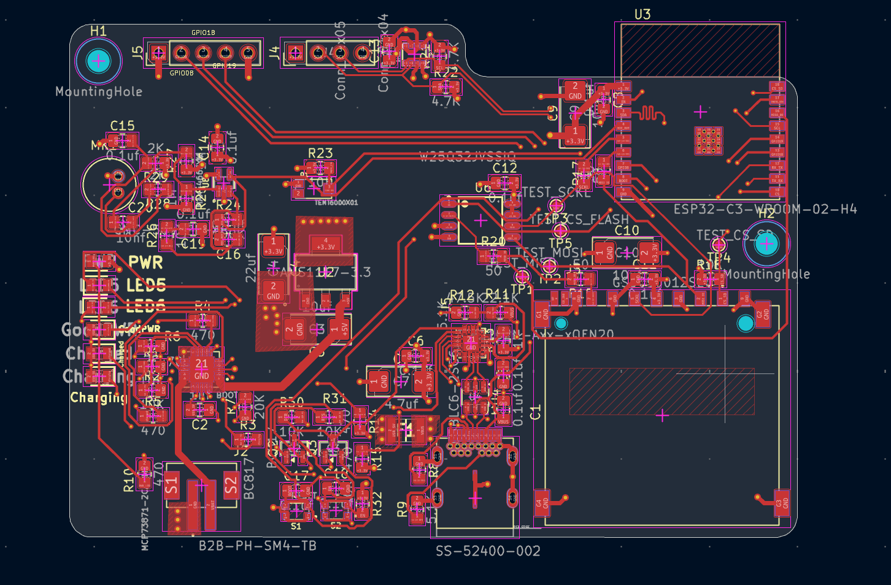
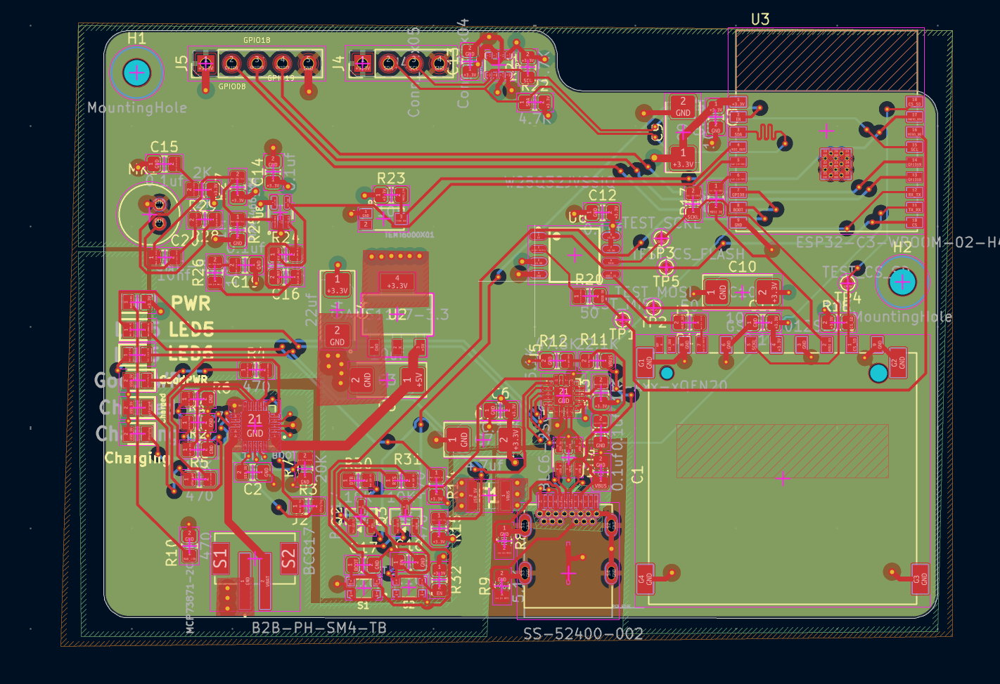
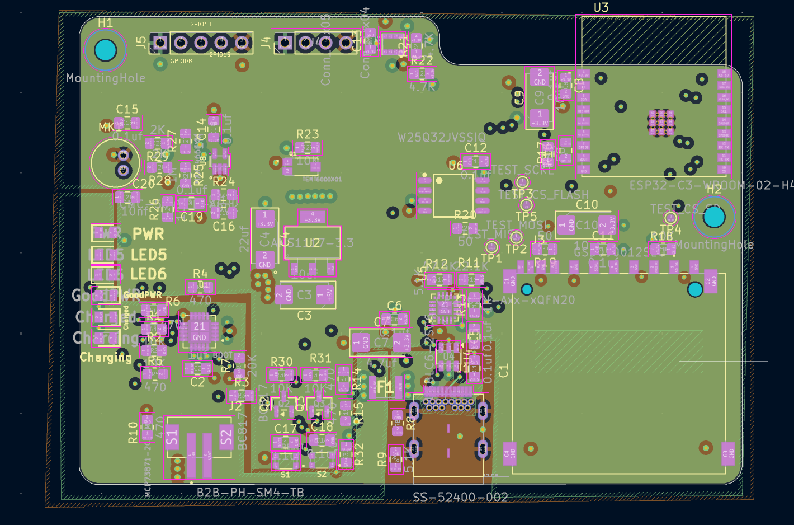

# ESP IoT Board

Custom-built 4-layer PCB IoT development board featuring onboard sensors for weather, ambient light, and audio processing, along with display support and integrated Wi-Fi/Bluetooth capabilities.

---

## Features

* **Sensors**: Temperature, humidity, pressure (BME280), and ambient light sensing.
* **Audio**: Microphone input with MAX4466EXK amplifier circuit.
* **Connectivity**: Integrated Wi-Fi and Bluetooth via ESP32-C3.
* **Power & Charging**: Onboard LiPo battery charger circuit (MCP73871) with USB power path management.
* **Storage & Expansion**: External Flash memory (W25Q32JVSSIQ) and MicroSD card slot.
* **Display Support**: Display header interface for external screens.
* **Interface**: USB Serial communication and power/charging over USB.

---

## Motivation

I designed this to gain hands-on experience in 4-layer PCB design for complex and high-density PCBS.

---

## PCB Layout

### Signal Layers (F.Cu & B.Cu)

### Power & Ground Planes (In1.Cu & In2.Cu)

---

## Project Directory Structure

| Path / File | Description |
| :--- | :--- |
| `3D models/` | 3D models for components|
| `Footprints/` | KiCad footprints used in the project |
| `Pictures/` | Image assets and PCB screenshots|
| `production/` | Production files (Gerbers, drill files, assembly outputs) |
| `Symbols/` | Custom KiCad schematic symbol library |
| `ESP IOT dev board.kicad_pcb` | Main KiCad PCB layout file |
| `ESP IOT dev board.kicad_sch` | Root schematic file |
| `esp32.kicad_sch` | ESP32-C3 microcontroller schematic sheet |
| `sensors.kicad_sch` | Environmental and audio sensor schematic sheet |
| `user_interface.kicad_sch` | Display and user interface schematic sheet |
| `README.md` | Project documentation |

---

## Bill of Materials (BOM)
| Component | Description | Est. Unit Cost (USD) |
| :--- | :--- | :--- |
| **ESP32-C3-WROOM-02** | Wi-Fi & BLE Microcontroller Module | ~$4.00 |
| **BME280** | Temperature, Humidity, & Pressure Sensor | ~$2.50 |
| **Light Sensor (LDR / Phototransistor)** | Ambient Light Sensing | ~$0.40 |
| **MAX4466EXK+T** | Low-Noise Microphone Amplifier IC | ~$1.20 |
| **Electret Condenser Microphone** | 2-pin Audio Input | ~$1 |
| **Winbond W25Q32JVSSIQ** | 32M-bit (4MB) SPI Flash Memory | ~$0.50 |
| **MCP73871** | LiPo Battery Charger & Power Path Management IC | ~$1.80 |
| **MicroSD Card Holder** | Push-Push / Push-Pull Socket | ~$1 |
| **USB Type-C Connector** | 16-pin / 24-pin Surface Mount Connector | ~$0.35 |
| **LiPo Battery** | 3.7V Single Cell Lithium-Polymer Battery | ~$3.50 |
| **Miscellaneous Components** | Resistors, Capacitors, LEDs, LDO, Connectors | ~$5.00 |
| **PCB Manufacturing** | Custom 4-Layer PCB Fabrication | ~$8.00 |
| **Shipping Fees** | Component & PCB Shipping | ~$15.00 |
| **Total Estimated Cost** | *(Including Fabrication & Shipping)* | **~$45** |

---

~ built with love ❤️